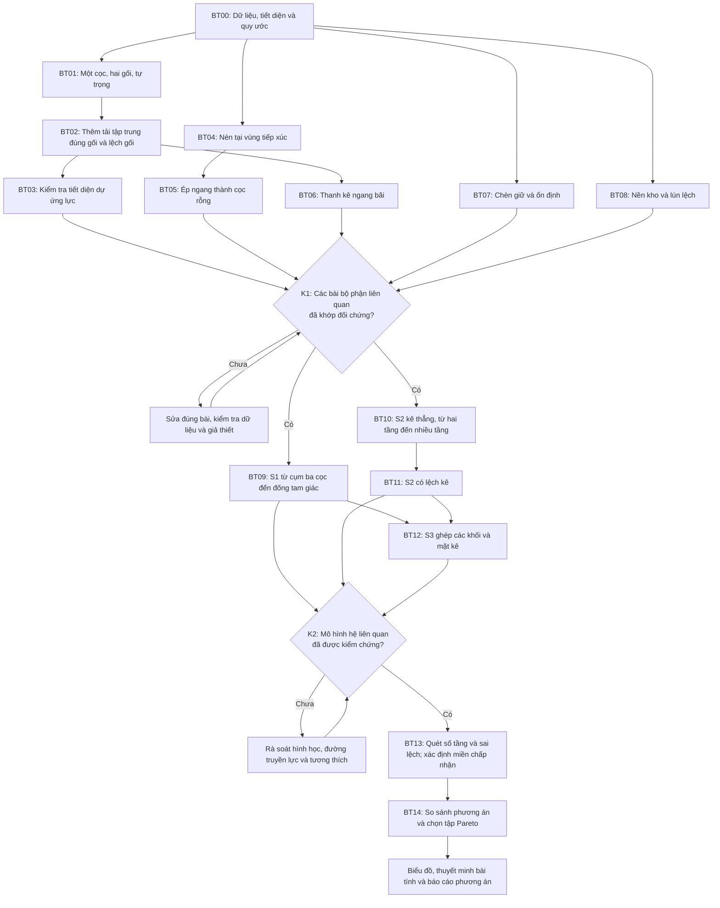
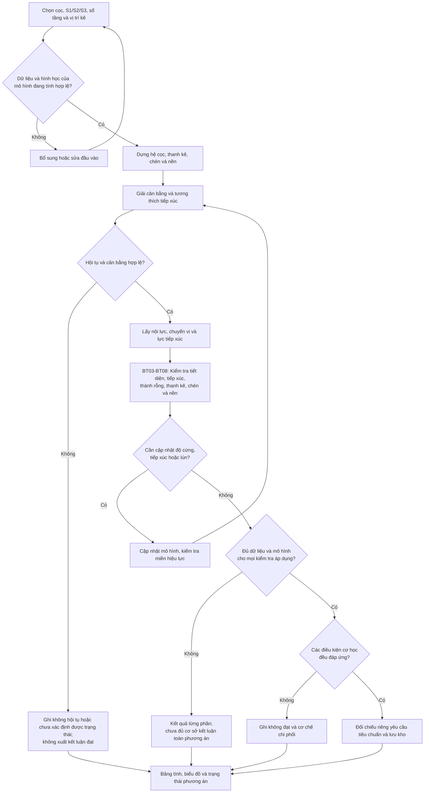
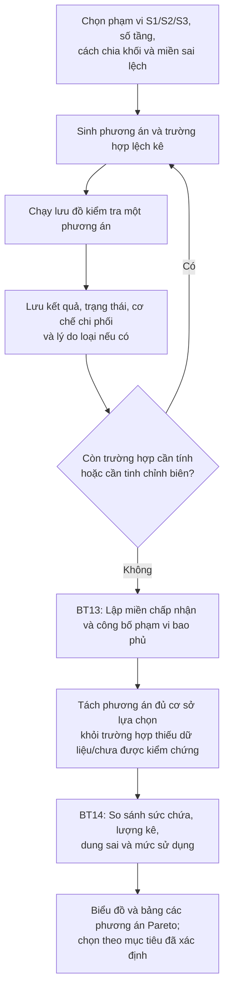

# Kế hoạch phát triển: Web App Tính toán & Đánh giá Xếp cọc Bê tông Ly tâm trong Kho

**Phiên bản kế hoạch:** 0.3.1 — cập nhật ngày 16/11/2026.
**Trạng thái:** Đặc tả trước triển khai; chưa có kết quả tính toán định lượng được kiểm chứng.

## 1. Mục tiêu và phạm vi

Xây dựng ứng dụng web tĩnh để kiểm tra, so sánh và tìm phương án xếp cọc theo ba sơ đồ tại mục 2. Kết quả gồm nội lực, chuyển vị, phản lực, lực tiếp xúc, mức sử dụng khả năng chịu lực, số tầng và dung sai đặt kê tương ứng.

- Xác định giới hạn tính toán theo mô hình, dữ liệu và các trường hợp đã kiểm chứng; thể hiện cơ chế chi phối kết quả.
- Giữ riêng kết quả kiểm tra cơ học, đối chiếu tiêu chuẩn áp dụng và phương án đề nghị sử dụng.
- Tìm quan hệ giữa số tầng, cách chia khối xếp và độ lệch kê; so sánh số cọc chứa được, diện tích bãi và lượng vật liệu kê.
- Phạm vi khởi đầu đề xuất: cọc PHC thẳng, trục song song, cùng đường kính, chiều dày và chiều dài trong một đống; tải trọng lưu kho tĩnh. Các trường hợp khác cần được định nghĩa và kiểm chứng trước khi mở rộng.
- Giai đoạn nâng, hạ, vận chuyển và va chạm là các trường hợp tải riêng nếu bổ sung; không dùng trực tiếp hệ số của các giai đoạn đó cho mọi trường hợp lưu kho.

## 2. Ba sơ đồ kê bắt buộc hỗ trợ

Quy ước: trục x dọc cọc, y ngang bãi, z thẳng đứng. Một cặp gối/thanh kê gồm hai vị trí dọc cọc x1 và x2; cần khai báo chiều dài thanh theo y và phạm vi các cọc mà thanh thực sự đỡ.

| Mã | Sơ đồ | Dữ liệu hình học cần có | Trọng tâm kiểm tra |
|---|---|---|---|
| S1 | Các cọc xếp tam giác, tỳ trực tiếp lên nhau; chỉ tầng đáy đặt trên hai gối/thanh kê | Số cọc từng hàng, tọa độ tâm cọc, vị trí hai kê đáy, hình học chèn giữ | Lực tiếp xúc nghiêng, uốn dọc, ép ngang thành cọc, xu hướng lăn và đẩy ngang ở đáy |
| S2 | Hai gối/thanh kê ở mọi tầng, bố trí thẳng đứng từ trên xuống dưới; khảo sát lệch kê | Số cọc từng tầng; x1, x2 của từng mặt kê; kích thước, vật liệu và độ cứng thanh kê | Uốn và cắt do tải truyền lệch vị trí, ứng suất/nứt, ép tiếp xúc, thanh kê và nền |
| S3 | Hỗn hợp: vài tầng tỳ trực tiếp, sau đó một mặt có hai kê, rồi tiếp tục xếp trực tiếp | Số tầng mỗi khối, ví dụ [3, 2, 3]; mặt đặt kê, số cọc từng hàng và vị trí các kê | Tải tích lũy qua nhiều khối, tiếp xúc ở mặt chuyển tiếp, vị trí tầng chèn kê và dung sai |

### 2.1. Cách biểu diễn thống nhất

- Khai báo từng tầng cọc và từng mặt tiếp giáp: tiếp xúc trực tiếp hoặc qua cặp thanh kê. Tầng đáy có cặp kê nền ở cả ba sơ đồ.
- Chuỗi số tầng mỗi khối chỉ là cách nhập nhanh cho S3; vẫn phải kiểm tra số cọc từng hàng, bề rộng, cao độ và tính khả thi hình học tại mặt chuyển tiếp.
- Mỗi tiếp xúc phải biết hai đối tượng, vị trí/phạm vi dọc cọc, hướng pháp tuyến và đặc tính tiếp xúc.
- Thanh kê trung gian truyền tiếp tải xuống dưới; không làm mất tải tích lũy và không được coi là một nền độc lập.
- Tiếp xúc trực tiếp giữa các cọc có thể kéo dài dọc thân. Không mặc định mọi tải chỉ tác dụng tại hai vị trí kê đáy hoặc phân bố đều trên toàn chiều dài.

## 3. Mô hình cơ học

### 3.1. Cọc, thanh kê và đường truyền lực

- Mô hình cọc bằng phần tử dầm phù hợp, xét dự ứng lực trong kiểm tra tiết diện. Phải xét được tải theo cả hai phương ngang và đứng khi lực tiếp xúc nghiêng của S1/S3 yêu cầu; một mô hình dầm chỉ chịu uốn đứng không đủ cho mọi sơ đồ.
- Mô hình cấu tạo tiết diện là hàm theo tọa độ dọc trục cọc `section(x)`: phải phân biệt **vùng gia cường hai đầu cọc** (đoạn `L_dau`, thường có cốt đai xoắn bước dày / nhiều lớp và cốt dọc gia cường chiều dài `L2`) với **vùng thân giữa** (cốt đai xoắn bước thưa) để lấy đúng đặc trưng thép/đai tại tọa độ mặt cắt và vị trí gối kê `x1, x2`.
- Tự trọng lấy theo tiết diện và trọng lượng thể tích hoặc khối lượng dài có nguồn xác nhận; kiểm tra sự nhất quán của hai cách nhập.
- Mô hình các thanh kê dùng chung theo bề rộng với độ cứng, chiều dài đỡ và các điểm tỳ thực tế. Chỉ cho phép giả thiết thanh tuyệt đối cứng khi có cơ sở; không tự chia đều tải cho các cọc bên dưới.
- Tính cân bằng và tương thích biến dạng của hệ cọc–kê–tiếp xúc. Không quy đổi mặc định n tầng thành tải phân bố n lần tự trọng trên mọi cọc.
- Xét từng cọc, từng tầng và từng tiếp xúc; không mặc định cọc ở tầng thấp nhất luôn chi phối tất cả kiểm tra.

### 3.2. Tiếp xúc và ổn định

- Tiếp xúc cọc–cọc và cọc–kê chỉ truyền nén theo phương pháp tuyến; cho phép tách khi mất tiếp xúc. Lực tiếp xúc và độ hở phải thỏa điều kiện không xuyên qua, không chịu kéo và điều kiện bổ sung của bài toán tiếp xúc.
- Trong các sơ đồ có tiếp xúc trực tiếp dọc thân (S1 và khối xếp trực tiếp của S3), phải rời rạc hóa các cặp nút tiếp xúc một phía (unilateral contact) dọc theo các phần tử dầm theo trục `x` trong `contact_solver.js` để bắt được hiện tượng chênh lệch độ võng uốn giữa các tầng gây tách hở cục bộ và tập trung lực tiếp xúc về gần vùng gối kê `x1, x2`.
- Phân bố lực khi có nhiều tiếp xúc phụ thuộc độ cứng và biến dạng; không gán tỷ lệ 50/50 cho mọi trạng thái.
- Ma sát, chèn giữ và độ cứng nền là dữ liệu có nguồn hoặc giả thiết được ghi rõ. Không tự khóa chuyển vị ngang của cọc biên để tạo ổn định giả.
- Kiểm tra xu hướng lăn, trượt, xòe chân đống, lực lên chèn và phản lực nền; trạng thái mất ổn định hoặc không tìm được cân bằng hợp lệ phải được báo riêng.
- Lưu trạng thái hội tụ, cân bằng lực/mômen và tập tiếp xúc đang hoạt động cho từng phương án.

### 3.3. Các kiểm tra sức bền

1. **Dọc cọc:** uốn, cắt, ứng suất bê tông, hình thành/độ mở nứt và chuyển vị theo bộ tiêu chuẩn cùng giai đoạn tải đã chọn. Phân biệt mômen nứt, mômen cực hạn và sức kháng thiết kế; kiểm tra cắt phải sử dụng đúng hàm lượng đai xoắn và cốt dọc theo vùng `section(x)` tại tiết diện đang xét (đặc biệt vị trí gần kê `x1, x2` thường rơi vào vùng đai thưa ở thân giữa).
2. **Tiếp xúc cục bộ:** nén tại diện tiếp xúc với thanh kê hoặc cọc khác; xét diện tiếp xúc thực tế và tính biến dạng của vật liệu kê.
3. **Thành cọc rỗng:** uốn theo vòng, nứt và ép vỡ cục bộ theo hàm lượng đai vòng thực tế tại vùng tiếp xúc `section(x)`. Dự ứng lực dọc không được tự coi là dự ứng lực vòng; kiểm tra ứng suất trung bình R/A không thay thế kiểm tra này.
4. **Thanh kê/chèn:** uốn, cắt, nén và biến dạng phù hợp vật liệu, hướng thớ nếu dùng gỗ, cùng khả năng giữ cọc biên.
5. **Nền kho:** áp lực, khả năng chịu tải và ảnh hưởng lún lệch theo dữ liệu nền đã khai báo.

Mô hình vòng đàn hồi có thể dùng để sàng lọc ép ngang. Trường hợp tiếp xúc hữu hạn, tương tác ứng suất hoặc nứt phức tạp cần mô hình shell/solid và/hoặc thí nghiệm để kiểm chứng. Bảng tra hay mô hình rút gọn trên web phải công bố miền hiệu lực; không ngoại suy ra ngoài miền đã kiểm chứng.

## 4. Tính độ lệch kê cho phép theo số tầng

### 4.1. Phải phân biệt hai cách định nghĩa dung sai

- **Theo trục chuẩn chung:** vị trí mỗi kê lệch so với vị trí danh định của cùng tuyến kê. Hai tầng lệch ngược phía có thể tạo lệch tương đối lớn hơn dung sai của một tầng.
- **Theo hai mặt kê liên tiếp:** giới hạn độ lệch tương đối giữa hai mặt kê. Độ lệch so với kê đáy có thể cộng dồn theo chiều cao.
- Tách độ lệch của tuyến kê trái/phải, dịch chuyển cùng chiều, ngược chiều và thay đổi khoảng cách hai gối. Khi mở rộng sang lệch ngang hoặc chênh cao phải có biến và kiểm tra riêng.

### 4.2. Phương pháp khảo sát

- Với mỗi sơ đồ và số tầng n, giải trạng thái danh định trước; sau đó khảo sát các kịch bản lệch kê và xác định điều kiện chi phối.
- Kịch bản tối thiểu: một mặt kê bị lệch; nhiều mặt lệch cùng chiều; lệch xen kẽ; hai tuyến kê lệch độc lập; tích lũy sai lệch qua các mặt kê của S3.
- Độ lệch cho phép phụ thuộc số tầng, vị trí mặt kê, cách chia khối, tải, cấu tạo cọc, thanh kê và nền; không có một giá trị chung cho mọi đống cọc.
- Phân biệt **dung sai khảo sát theo các kịch bản đã tính** và **bao dung sai được bảo đảm cho miền sai lệch đã định nghĩa**. Quét một số trường hợp không đủ để tuyên bố đã bao phủ mọi tổ hợp sai lệch.
- Nếu tìm bao dung sai, phải kiểm tra được trường hợp bất lợi trong toàn miền bất định bằng phương pháp có cơ sở. Khi chưa làm được, kết quả chỉ mang trạng thái khảo sát.
- Không mặc định đáp ứng đơn điệu theo độ lệch để tìm kiếm nhị phân. Phải kiểm tra thay đổi tiếp xúc, ổn định và vùng chấp nhận liên thông chứa trạng thái danh định.
- Trạng thái danh định không đạt hoặc thiếu dữ liệu kiểm tra không được xuất một dung sai mang kết luận đạt.

Kết quả: bảng và biểu đồ độ lệch cho phép theo n, vị trí kê và kịch bản; kèm cọc/tầng/tiếp xúc chi phối, giới hạn hình học và phạm vi đã kiểm chứng.

## 5. Tìm phương án kê tối ưu

- Biến phương án: S1/S2/S3; số tầng; số cọc từng hàng; cách chia khối S3; mặt đặt thanh kê; vị trí danh định x1, x2; kích thước/vật liệu kê trong thư viện được xác nhận.
- Ràng buộc: hình học hợp lệ, cân bằng ổn định, các kiểm tra sức bền, nền, dung sai yêu cầu và các yêu cầu của tiêu chuẩn áp dụng.
- So sánh công bằng trên cùng loại cọc, điều kiện bãi và giới hạn tài nguyên. Cùng số tầng nhưng khác số cọc từng hàng không có cùng sức chứa.
- Các chỉ tiêu: số cọc trên diện tích bãi; số lượng/thể tích thanh kê; dung sai đặt kê; mức sử dụng khả năng chịu lực lớn nhất.
- Khi chưa có trọng số hoặc mục tiêu ưu tiên của người dùng, xuất các phương án Pareto: không có phương án nào tốt hơn đồng thời ở mọi chỉ tiêu. Không tự gộp các chỉ tiêu bằng trọng số tùy ý để tuyên bố một phương án tối ưu duy nhất.
- Liệt kê phương án trong miền tìm kiếm đã khai báo và lưu dấu vết loại phương án; ghi rõ kết quả tốt nhất trong miền đã xét hay đã chứng minh tối ưu toàn miền.
- Kiểm tra riêng độ nhạy với các tham số chưa chắc chắn như dự ứng lực hữu hiệu, ma sát, độ cứng kê, diện tiếp xúc và lún lệch.

## 6. Dữ liệu cọc, thanh kê, nền — Tự nhập hoặc chọn từ bản vẽ tham khảo

Bộ 33 bản vẽ chuẩn Phan Vũ trong thư mục tham khảo cục bộ [Ref/Ban ve Coc chuan Phan Vu/](./Ref/Ban%20ve%20Coc%20chuan%20Phan%20Vu/) (`PHC D300A` đến `D1000C`, TCVN 7888, phiên bản 1.2) chỉ đóng vai trò **thư viện bản vẽ tham khảo (Preset/Reference Library)**. Ứng dụng bắt buộc hỗ trợ **hai chế độ nhập liệu linh hoạt** cho cả thông số cọc lẫn thông số thanh kê, nệm chèn và nền kho:

1. **Chọn từ thư viện bản vẽ tham khảo:** Chọn nhanh mã cọc chuẩn từ `data_in/pile_specs.json` (và cấu hình kê/nền mẫu từ `data_in/support_ground_specs.json`), chọn hoặc nhập chiều dài đoạn cọc `L` thực tế cần xếp, đồng thời cho phép người dùng chỉnh sửa/ghi đè (override) bất kỳ thông số nào trên giao diện trước khi tính.
2. **Tự nhập thông số bản vẽ mới (Custom Input):** Người dùng tự nhập toàn bộ thông số từ bản vẽ sản xuất hoặc thiết kế riêng:
   - Hình học tiết diện & chiều dài: `Do, Dp, Di, t, L`, độ thẳng và dung sai chế tạo (nếu có).
   - Vật liệu bê tông: cường độ nén/kéo, loại mẫu thử (mẫu trụ `D150xH300` hay mẫu lập phương `150x150x150`), tuổi/giai đoạn, môđun đàn hồi và trọng lượng thể tích `\gamma_c` (hoặc khối lượng dài).
   - Thép dự ứng lực (PC Bar): đường kính `\varnothing_PC`, số lượng `N1`, giới hạn bền `f_pu`, giới hạn chảy quy ước `f_py`, môđun đàn hồi `E_p`, lớp bảo vệ và ứng suất nén hữu hiệu `\sigma_pc` (hoặc lực căng ban đầu và tỷ lệ tổn hao).
   - Thép đai xoắn theo từng vùng dọc trục `x`: đường kính `\varnothing_Fs`, bước đai và số lớp tại **vùng đầu cọc** (`L_dau`, ví dụ `2Do`) và tại **vùng thân giữa** (để xác định hàm `section(x)`).
   - Thép dọc gia cường đầu cọc (nếu có): đường kính `\varnothing_GC`, số lượng `N2`, chiều dài đoạn gia cường `L2`.
   - Chi tiết đầu cọc (mặt bích, măng xông) và các giá trị công bố trên bản vẽ (`M_cr`, `M_u`, tải thi công nếu có) để tham chiếu/đối chứng.
   - Hỗ trợ lưu/nạp và nhân bản cấu hình cọc tự nhập thông qua JSON và LocalStorage để tái sử dụng cho các phiên làm việc sau.

### 6.1. Cấu trúc một bản ghi cọc

- Thông tin định danh & nguồn: mã sản phẩm, nguồn dữ liệu (`Thư viện tham khảo` / `Người dùng tự nhập` / `Tham khảo đã chỉnh sửa`), nhà sản xuất, tiêu chuẩn/phiên bản, cấp tải, mã bản vẽ và lần sửa đổi.
- Hình học & khối lượng: `Do, Dp, Di, t, L`, chi tiết mặt bích/măng xông (nếu có), khối lượng dài hoặc trọng lượng thể tích `\gamma_c`, độ thẳng và dung sai hình học liên quan.
- Vật liệu bê tông: cường độ nén/kéo, **quy cách mẫu thử** (trụ `D150xH300` hay lập phương `150x150x150`), môđun đàn hồi `E_b`, tuổi/giai đoạn tương ứng. Phải có quy tắc quy đổi rõ ràng từ cường độ mẫu trụ (ví dụ `80 MPa` trên bản vẽ tham khảo) hoặc mẫu lập phương sang các đặc trưng tính toán (`R_b, R_bt, E_b` theo TCVN 5574:2018; `f_ck, f_ctm, E_cm` theo Eurocode 2 / ACI / JIS / SP / GB) theo đúng hệ số chuyển đổi của từng tiêu chuẩn.
- Cốt thép theo phân vùng dọc trục `x`:
  - Thép dự ứng lực: `\varnothing_PC, N1`, vị trí vòng bố trí `Dp`, diện tích `A_p`, `f_pu, f_py, E_p`, lớp bảo vệ.
  - Thép gia cường đầu cọc: `\varnothing_GC, N2, L2`.
  - Thép đai xoắn: `\varnothing_Fs`, bước đai và số lớp theo vùng `L_dau` và vùng giữa thân.
- Dự ứng lực hữu hiệu `\sigma_pc`: hỗ trợ 3 cách xác lập rõ nguồn: (i) người dùng nhập trực tiếp `\sigma_pc` (hoặc lực căng hữu hiệu), (ii) tính từ ứng suất căng ban đầu và tổn hao theo tiêu chuẩn đang chọn, và (iii) **đối chiếu ngược (back-check)** với mômen nứt `M_cr` và mômen phá hủy `M_u` công bố trên bản vẽ (nếu được nhập/có sẵn) để báo cáo độ khớp và phạm vi sai số.
- Mômen nứt `M_cr`, mômen cực hạn `M_u` và khả năng cắt công bố/thí nghiệm nếu có; ghi đúng định nghĩa, đơn vị và điều kiện thử.
- Trạng thái xác nhận & nguồn cho từng nhóm thông số: bản vẽ tham khảo, người dùng nhập, giá trị mặc định/giả thiết hay đã xác nhận.

### 6.2. Nguyên tắc sử dụng

- Các thông số trong `data_in/pile_specs.json` (trích từ 33 bản vẽ tham khảo D300–D1000, loại A/AB/B/C) và `data_in/support_ground_specs.json` (thông số mẫu thanh kê gỗ/thép/bê tông, đệm chèn, hệ số nền) là giá trị khởi tạo tiện lợi; không coi cùng tên cấp tải hoặc mác bê tông của các nước là tương đương nếu chưa đối chiếu.
- Phân biệt rạch ròi giữa dữ liệu lấy nguyên bản từ thư viện tham khảo, dữ liệu tham khảo đã bị người dùng chỉnh sửa, dữ liệu tự nhập mới hoàn toàn và giả thiết mặc định.
- Chế độ tương tự (chọn từ thư viện tham khảo hoặc tự nhập mới và lưu JSON) áp dụng đồng bộ cho thanh kê (vật liệu, tiết diện, `E`, `f_c\perp`, `f_c\parallel`, hệ số ma sát), nệm chèn và nền kho.
- Thiếu dữ liệu bắt buộc của một kiểm tra phải hiển thị trạng thái “chưa đủ dữ liệu” (nhất là khi người dùng tự nhập thiếu thông số thép đai hoặc `\sigma_pc`); không được ngầm điền giá trị lạc quan hay coi kiểm tra đó đạt.
- Tách dữ liệu mô tả vật lý của cọc khỏi mô hình vật liệu thiết kế của từng tiêu chuẩn; kiểm soát đơn vị và mọi phép chuyển đổi cường độ theo quy cách mẫu thử.

## 7. Tiêu chuẩn và nghiên cứu đối chứng

### 7.1. Hệ tiêu chuẩn dự kiến

- Việt Nam: TCVN 5574:2018 cho kiểm tra kết cấu; TCVN 7888:2014 cho sản phẩm và yêu cầu bảo quản liên quan.
- Châu Âu: Eurocode 2 theo bộ phiên bản và Phụ lục quốc gia được chọn; EN 12794 cho cọc đúc sẵn.
- Nga: SP 63.13330.2018 cùng các sửa đổi áp dụng; GOST 19804-2021 cho sản phẩm cọc và lưu kho.
- Nhật: JIS A 5373:2016, phần cọc/đặc tính E-1; JIS A 7201:2009; tài liệu kỹ thuật COPITA.
- Mỹ: PCI Recommended Practice 2019 cùng đính chính liên quan; ACI PRC-543 và bộ quy định bê tông được chọn.
- Trung Quốc: GB/T 13476-2023; GB/T 50010-2010 bản sửa đổi 2024; yêu cầu thi công/lưu kho phù hợp phạm vi sử dụng.

Mỗi bộ kiểm tra phải ghi rõ nguồn, phiên bản, điều khoản, tổ hợp tải, hệ số và miền áp dụng. Không trộn hệ số tải của hệ này với sức kháng của hệ khác. Mô hình tiếp xúc/ép ngang ngoài phạm vi một công thức tiêu chuẩn cần được công bố và kiểm chứng riêng.

S1 và S3 phải được đối chiếu riêng về yêu cầu tấm kê giữa các tầng; tính được cân bằng hoặc sức bền không tự đồng nghĩa phù hợp quy định bảo quản. Tính toán độ nhạy do lệch kê không tự thay thế yêu cầu bố trí kê của tiêu chuẩn áp dụng.

### 7.2. Nguồn nghiên cứu đã nhận diện

- [PCI Recommended Practice 2019](https://ems-www.pci.org/PCI_Docs/Publications/PCI%20Journal/2019/July-August/RP_Concrete%20Piling_JA19.pdf): kiểm tra giai đoạn trước sử dụng, vị trí kê và bố trí kê thẳng đứng.
- [COPITA — thông tin kỹ thuật cọc](https://www.c-pile.or.jp/tech): nguồn đối chiếu đặc tính sản phẩm theo JIS.
- [Nghiên cứu uốn cọc ly tâm kích thước thực, 2025](https://doi.org/10.1016/j.engstruct.2025.121071): thí nghiệm và mô hình FEM; cần toàn văn và dữ liệu phù hợp để làm bộ hiệu chỉnh.
- [Nghiên cứu cắt cọc PHC, 2023](https://doi.org/10.1007/s40999-022-00748-7): ảnh hưởng nhịp cắt, lực dọc và cấu tạo cốt thép.
- [Nghiên cứu mô hình ép ba cạnh ống bê tông, 2016](https://doi.org/10.1016/j.engstruct.2016.06.014): tham khảo phương pháp mô hình hóa vòng; vật liệu và cấu tạo khác PHC nên không dùng trực tiếp giá trị sức chịu tải.

Danh sách này là cơ sở định hướng. Việc mã hóa công thức và dùng kết quả làm chuẩn kiểm chứng phải dựa trên nội dung đầy đủ cùng điều kiện biên tương ứng.

## 8. Biểu đồ, giao diện và báo cáo

1. Mặt cắt y–z của đống cọc: từng hàng, tiếp xúc trực tiếp, mặt có kê, chèn và số thứ tự tầng/khối.
2. Sơ đồ dọc x–z và mặt bằng vị trí kê: hai tuyến kê, vị trí danh định/thực tế, độ lệch và đường truyền tải.
3. Biểu đồ M(x), Q(x), chuyển vị theo cọc/tầng; hiển thị cả vị trí tải và gối để kiểm tra mô hình.
4. Phản lực, lực tiếp xúc và mức sử dụng khả năng chịu lực theo tầng/cọc; đánh dấu vị trí chi phối.
5. Quan hệ số tầng–độ lệch kê cho phép, đồng thời thể hiện phạm vi khảo sát và cơ chế giới hạn.
6. Bản đồ miền chấp nhận (n, độ lệch) cho từng sơ đồ/cách chia khối S3; tách các mức đã kiểm chứng và chưa đủ dữ liệu.
7. Đồ thị Pareto và bảng so sánh phương án về sức chứa, lượng kê, dung sai, mức sử dụng và trạng thái đối chiếu tiêu chuẩn.

Ưu tiên hiển thị hệ số sử dụng theo từng kiểm tra. Nếu dùng FS = sức kháng/tác động thì phải định nghĩa riêng, giữ nhất quán cơ sở tải và sức kháng; không gộp tùy ý mọi trạng thái vào một FS chung.

Báo cáo có sơ đồ, dữ liệu/nguồn, giả thiết, trường hợp tải và lệch kê, phiên bản mô hình/tiêu chuẩn, tiêu chí kiểm tra, cơ chế chi phối và phạm vi hiệu lực. Cho phép lưu/nạp JSON phương án, xuất bảng CSV và báo cáo HTML/in PDF qua trình duyệt.

## 9. Kiểm chứng và điều kiện nghiệm thu

- Đối chứng bài toán dầm tự trọng có hai gối và đoạn hẫng; tải tập trung tại gối; tải lệch gối; so sánh nghiệm giải tích/bài tính độc lập.
- Kiểm tra rằng tải tầng trên đặt đúng tại các gối lý tưởng không bị biến thành tải phân bố gây thêm mômen giả trên toàn cọc.
- Đối chứng S1 đối xứng, cọc biên, lực đẩy ngang/chèn giữ; kiểm tra ổn định và mất tiếp xúc khi thay đổi điều kiện biên.
- Đối chứng S2 thẳng hàng, lệch một mặt kê, lệch xen kẽ và cộng dồn; kiểm tra độc lập hai tuyến kê.
- Kiểm tra tải tích lũy qua từng thanh kê của S3. Các cấu hình giới hạn phải quy về đúng S1 hoặc S2 khi loại/bổ sung mặt kê tương ứng.
- Kiểm tra cân bằng lực và mômen từng bộ phận/cả hệ, điều kiện tiếp xúc, hội tụ và độ nhạy độ cứng tiếp xúc. Đặt ngưỡng sai số định lượng trước cho từng bài toán chuẩn.
- Đánh giá hội tụ lưới trên phản lực, nội lực và chuyển vị; không dùng ứng suất đỉnh tại một điểm tiếp xúc lý tưởng làm tiêu chí chịu lực chưa được hiệu chỉnh.
- Kiểm tra tiết diện bằng dữ liệu sản phẩm/thí nghiệm phù hợp; kiểm chứng ép ngang riêng theo cấu tạo, vùng tiếp xúc và điều kiện tải thực tế.
- Bộ hồi quy bao gồm sai đơn vị, thiếu dự ứng lực, dữ liệu hình học không hợp lệ, mất ổn định, không hội tụ và ngoài miền hiệu lực. Các trạng thái này không được xuất kết luận đạt hoặc tối ưu sử dụng.

## 10. Kiến trúc và cấu trúc thư mục dự kiến

- SPA chạy 100% client-side: HTML5, Tailwind CSS qua CDN, JavaScript ES6 Modules; chạy trên GitHub Pages hoặc web server nội bộ.
- Dùng Plotly.js cho sơ đồ, đường cong và bản đồ miền chấp nhận; thống nhất thư viện trực quan hóa trong bản đầu.
- Tách nghiệp vụ xếp cọc và bộ kiểm tra tiêu chuẩn khỏi lõi FEM/tiếp xúc dùng chung.
- Tính hệ tiếp xúc, quét sai lệch và tối ưu trong Web Worker. Chọn cách lưu/giải hệ phù hợp kích thước bài toán, tránh mặc định ma trận đặc cho hệ nhiều cọc/phần tử.
- Mô hình 3D phi tuyến dùng để kiểm chứng có thể thực hiện ngoài web; dữ liệu rút gọn đưa lên web phải kèm nguồn, phạm vi và sai số đã đánh giá.

```text
/
├── src/
│   ├── ui/
│   │   ├── xep-coc.html             # Giao diện module
│   │   └── app.js                   # Form, sơ đồ và biểu đồ kết quả
│   ├── core/
│   │   ├── fem_solver.js            # Phần tử dầm, lắp ráp và giải hệ
│   │   └── contact_solver.js        # Tiếp xúc chỉ chịu nén và cân bằng
│   ├── modules/
│   │   └── xep-coc/
│   │       ├── pile_specs.js        # Đọc/kiểm tra dữ liệu cọc và nguồn
│   │       ├── stacking_model.js    # Hình học và đường truyền lực S1/S2/S3
│   │       ├── support_checker.js   # Thanh kê, chèn, nền và ổn định
│   │       ├── section_checker.js   # Uốn, cắt, ứng suất và nứt
│   │       ├── contact_checker.js   # Nén tiếp xúc và ép ngang thành cọc
│   │       ├── standards/           # Bộ kiểm tra độc lập theo tiêu chuẩn
│   │       ├── tolerance_scan.js    # Khảo sát lệch kê và phạm vi bao phủ
│   │       └── optimizer.js         # Tìm phương án và so sánh Pareto
│   └── workers/
│       └── calculation_worker.js
├── data_in/
│   ├── pile_specs.json              # Thư viện bản vẽ cọc tham khảo (D300–D1000) có nguồn & trạng thái xác nhận
│   ├── support_ground_specs.json    # Thư viện tham khảo thanh kê, nệm chèn và nền kho
│   └── examples/                    # Phương án mẫu của ba sơ đồ
├── data_out/
│   └── report_template.html
├── docs/
│   ├── HDSD_xep-coc.md
│   └── co-so-tinh-toan_xep-coc.md
├── tests/                           # Bài toán chuẩn và kiểm tra hồi quy
├── .gitignore
├── index.html                       # Dashboard điều hướng module
├── CHANGELOG.md                     # SemVer theo phiên bản phần mềm
└── README.md
```

## 11. Chia thành các bài tính và lưu đồ thực hiện

### 11.1. Cách tổ chức công việc

Chia thành một bài chuẩn hóa dữ liệu BT00 và 14 bài tính BT01–BT14. Mỗi bài có sơ đồ, đầu vào, đầu ra và đối chứng riêng. Hoàn thiện các bài đơn giản trước, sau đó tái sử dụng để ghép thành S1/S2/S3; cuối cùng mới quét dung sai và tối ưu.

Các bài kiểm tra bộ phận BT03–BT08 có thể nhận nội lực/lực tiếp xúc giả định đã định nghĩa để lập bài tính độc lập. Khi ghép hệ, thay những lực đầu vào này bằng kết quả cân bằng–tương thích của cả hệ; không giữ giả thiết lực cố định nếu biến dạng làm thay đổi phân phối tải.

Phân biệt hai kết luận:

- **Bài tính đã được kiểm chứng:** kết quả khớp nghiệm/bài tính độc lập hoặc thí nghiệm trong miền đã nêu. Một mẫu cố ý quá tải vẫn có thể là bài kiểm chứng đúng nếu kết luận không đạt khớp đối chứng.
- **Phương án xếp đáp ứng yêu cầu:** đủ dữ liệu, mô hình nằm trong miền hiệu lực và các kiểm tra áp dụng đều đáp ứng. Bài tính đã kiểm chứng không đồng nghĩa mọi phương án nhập vào đều đạt.

### 11.2. Lưu đồ thứ tự xây dựng và kiểm chứng



Lưu đồ thể hiện quan hệ phụ thuộc. Trong nhóm bài tính hệ, nên thử S2 kê thẳng và lệch kê trước vì có thể đối chứng trực tiếp từ BT01–BT02; sau đó hoàn thiện S1 và ghép thành S3. K1/K2 là cổng kiểm chứng phương pháp, không phải cổng kết luận phương án chịu lực đạt.

### 11.3. Danh mục bài tính độc lập

| Mã | Bài tính và phạm vi | Đầu vào chính | Đầu ra/bản vẽ kiểm tra | Đối chứng tối thiểu |
|---|---|---|---|---|
| BT00 | Chuẩn hóa thông số cọc, phân vùng `section(x)`, vật liệu, đơn vị và nguồn dữ liệu | Chọn từ thư viện tham khảo hoặc tự nhập thông số bản vẽ mới (`Do, Dp, Di, t, L`, bê tông + mẫu thử, thép DƯL, `\sigma_pc`, đai/gia cường theo `x`) | Bảng dữ liệu có nguồn; diện tích, `I`, `W`, tự trọng; quy đổi cường độ bê tông; kiểm tra ngược `M_cr/M_u` (nếu có); trạng thái thiếu dữ liệu | Tính hình học độc lập, kiểm tra đơn vị, khối lượng và quy đổi mẫu thử; phân biệt tiết diện hình học và tiết diện tính toán |
| BT01 | Một cọc đặt trên hai gối, có hai đoạn hẫng, chỉ chịu tự trọng | Dữ liệu cọc, x1, x2, độ cứng và điều kiện gối | Sơ đồ dọc; R1, R2; M(x), Q(x), chuyển vị; cực trị ở nhịp và đoạn hẫng | Nghiệm giải tích/bài tay; cân bằng lực và mômen; đối xứng khi hai gối đối xứng |
| BT02 | Một cọc nhận tải tập trung từ tầng trên, đúng gối rồi lệch gối | BT01, tải P và vị trí trên từng tuyến kê, phạm vi đặt tải nếu hữu hạn | Biểu đồ nội lực/chuyển vị; mức tăng mômen, lực cắt theo vị trí tải | Tải tại đúng gối lý tưởng chỉ tăng phản lực tương ứng; lệch bằng 0 quy về trường hợp đúng gối; kiểm tra hai tuyến độc lập |
| BT03 | Kiểm tra uốn, cắt, ứng suất và nứt của tiết diện cọc dọc thân | Dữ liệu `BT00` (`section(x)` theo vùng đầu cọc/thân giữa), nội lực `BT01/BT02` hoặc nội lực mẫu, giai đoạn và bộ tiêu chuẩn | Sức kháng/giới hạn tương ứng tại các vùng tiết diện; hệ số sử dụng riêng từng kiểm tra; cơ chế chi phối | Bài tính tiết diện độc lập, kiểm tra đúng vùng cốt đai tại `x1, x2`, dữ liệu sản phẩm/thí nghiệm phù hợp; tách giá trị nứt, cực hạn và thiết kế |
| BT04 | Nén tại vùng tiếp xúc cọc–kê và cọc–cọc | Lực pháp tuyến mẫu, hình học tiếp xúc, vật liệu và đặc tính biến dạng | Diện/phạm vi tiếp xúc, áp lực và giới hạn nén cục bộ; phạm vi hiệu lực mô hình | Cân bằng tích phân áp lực bằng lực đặt; trường hợp đơn giản có nghiệm độc lập hoặc thử nghiệm; không coi diện tiếp xúc bằng diện tiết diện cọc |
| BT05 | Ép ngang, uốn vòng và nứt thành cọc rỗng | Hình học/hàm lượng đai vòng `section(x)` đúng tại vùng tiếp xúc (đầu cọc hoặc thân giữa), các lực và vùng tiếp xúc từ BT04, vật liệu | Nội lực vòng/ứng suất, vị trí nứt dự kiến, mức sử dụng; giới hạn tải được kiểm chứng | Bài toán vòng đàn hồi chuẩn, mô hình shell/solid độc lập hoặc thí nghiệm phù hợp; ghi rõ điều kiện rút gọn và tương tác với ứng suất dọc |
| BT06 | Một thanh kê chạy ngang bãi, nhận tải phía trên và truyền xuống các cọc dưới | Kích thước/vật liệu kê (chọn mẫu hoặc tự nhập), vị trí điểm tỳ, tải và độ cứng các tiếp xúc | Phản lực trên từng cọc, M/Q/chuyển vị thanh kê, nén tiếp xúc và tính tương thích | Bài dầm đơn giản có nghiệm; tổng tải truyền xuống bằng tải phía trên cộng tự trọng; kiểm tra thanh mềm và giả thiết thanh cứng |
| BT07 | Chèn giữ và ổn định của cọc biên/đống cọc | Lực đứng/ngang và vị trí đặt, hình học chèn, ma sát, khả năng chịu lực chèn | Lực chèn, điều kiện chống trượt/lăn/xòe chân; vị trí mất ổn định | Cân bằng lực và mômen trên vật thể tách riêng; trường hợp bỏ chèn hoặc thiếu ma sát không được tự khóa ngang |
| BT08 | Hai tuyến kê nền trên nền kho | Phản lực mẫu, vị trí và diện kê, dữ liệu nền/độ cứng (chọn mẫu hoặc tự nhập) và chênh cao ban đầu | Áp lực nền, kiểm tra chịu tải, chuyển vị/lún lệch theo dữ liệu có sẵn | Cân bằng tải–phản lực; đối xứng với điều kiện đối xứng; trường hợp nền đàn hồi có đối chứng riêng |
| BT09 | S1: bắt đầu bằng ba cọc, hai cọc dưới và một cọc trên; sau đó tăng số hàng | Hình học tam giác, tự trọng, kê đáy, tiếp xúc một phía (unilateral) dọc thân theo `x` và chèn | Sơ đồ lực ở mặt cắt và dọc thân (phản ánh tách hở và tập trung lực gần gối `x1, x2`); phản lực, lực tiếp xúc nghiêng, nội lực và kiểm tra bộ phận | Cân bằng cụm ba cọc đối xứng trước; sau đó đối chứng hệ dầm–tiếp xúc dọc thân. Bài mặt cắt 2D riêng không thay thế kiểm tra dọc thân |
| BT10 | S2: hai tầng kê thẳng hàng, sau đó ba tầng và nhiều tầng | Số cọc mỗi tầng, dữ liệu cọc/kê/nền; các vị trí kê thẳng đứng | Tải truyền qua từng mặt kê; R, M, Q, chuyển vị và kết quả kiểm tra từng bộ phận | Tổng tải về nền bằng tự trọng cả hệ; đối chiếu BT01/BT02 ở trường hợp gối lý tưởng; không tạo mômen giả bằng tải phân bố nhân số tầng |
| BT11 | S2: giữ số tầng rồi thay đổi vị trí kê | BT10, lệch một tuyến/hai tuyến, lệch một mặt/nhiều mặt, mốc xác định sai lệch | Đường nội lực và mức sử dụng theo độ lệch; cọc/tầng chi phối và thay đổi tiếp xúc | Độ lệch bằng 0 khớp BT10; đối chứng trường hợp đơn giản bằng BT02; kiểm tra lệch cùng chiều, xen kẽ và cộng dồn |
| BT12 | S3: ghép hai khối xếp trực tiếp qua một mặt kê, sau đó nhiều khối | Dữ liệu S1/S2, số tầng mỗi khối, số cọc từng hàng và vị trí mặt kê | Tải tích lũy qua từng khối, phản lực thanh kê trung gian, nội lực/tiếp xúc và kiểm tra toàn hệ | Giữ tải truyền qua mặt nối; khi đổi loại mặt tiếp giáp phải quy về đúng S1 hoặc S2 tương ứng với cùng hình học và điều kiện biên |
| BT13 | Khảo sát miền số tầng–độ lệch cho từng sơ đồ/cách chia khối | Một mô hình hệ đã kiểm chứng, miền tìm kiếm, kịch bản sai lệch và dữ liệu kiểm tra | Bảng n–độ lệch; miền chấp nhận, không đạt, chưa đủ dữ liệu; cơ chế chi phối | Tính lại các điểm biên độc lập, tinh chỉnh bước quét, kiểm tra tiếp xúc/ổn định; chỉ gọi là bao dung sai khi đã có cơ sở bao phủ miền sai lệch |
| BT14 | So sánh cách kê và chọn phương án | Kết quả BT13, diện tích bãi, số cọc, lượng kê, dung sai yêu cầu và tiêu chuẩn áp dụng | Tập phương án Pareto, bảng xếp theo mục tiêu được chọn, giới hạn miền tìm kiếm | Liệt kê đủ một bài toán nhỏ để đối chứng thuật toán; chỉ so sánh các phương án trên cùng điều kiện và phân biệt tốt nhất đã khảo sát với tối ưu đã chứng minh |

BT07/BT08 là các bài độc lập với lực đầu vào cho trước khi lập bảng tính. Trong mô hình hệ, chèn giữ, ma sát và nền phải tham gia điều kiện biên/tương thích khi chúng ảnh hưởng đường truyền lực; không chỉ kiểm tra sau với một hệ đã bị khóa cứng tùy ý.

### 11.4. Mẫu thuyết minh áp dụng cho mỗi bài

Mỗi bài BTxx được lập theo cùng một cấu trúc để có thể kiểm tra riêng và tái sử dụng:

1. **Tên bài và mục tiêu:** đang kiểm tra mô hình, kiểm tra khả năng chịu lực hay khảo sát tham số; chỉ rõ S1/S2/S3 nếu liên quan.
2. **Sơ đồ:** đánh số cọc/gối/thanh kê, tọa độ, kích thước, tải, chiều phản lực và các điều kiện biên.
3. **Đầu vào:** giá trị, đơn vị, nguồn, giai đoạn, giả thiết và những dữ liệu còn thiếu; phân biệt bộ số liệu kiểm chứng với dữ liệu sản phẩm thực tế.
4. **Cơ sở tính:** công thức/mô hình, điều kiện áp dụng, tiêu chuẩn/phiên bản/điều khoản hoặc nguồn nghiên cứu; định nghĩa rõ từng hệ số.
5. **Trình tự tính:** dữ liệu trung gian, cân bằng, nội lực và các kiểm tra; trình bày đủ để tính lại bằng phương pháp độc lập.
6. **Kết quả:** bảng số, sơ đồ/biểu đồ có đơn vị, cực trị và vị trí chi phối; ghi trạng thái hội tụ/miền hiệu lực khi có.
7. **Đối chứng:** giá trị tham chiếu, nguồn đối chứng độc lập, thước đo sai số và ngưỡng chấp nhận đặt trước. Không coi hai cách trình bày dùng chung một thuật toán là hai đối chứng độc lập.
8. **Kết luận:** tách trạng thái kiểm chứng phương pháp khỏi trạng thái chịu lực; nêu phạm vi tái sử dụng và bài tiếp theo nhận kết quả này.

Sản phẩm của một bài gồm thuyết minh, bộ dữ liệu có thể lưu/nạp và kết quả đối chứng tái lập được. Không cần hoàn thiện toàn bộ giao diện hoặc bộ tối ưu để bắt đầu lập các bài BT00–BT08.

### 11.5. Lưu đồ chạy một phương án sau khi ghép các bài



Không đồng nhất không hội tụ với chứng minh mất ổn định; phải phân biệt nguyên nhân mô hình/số học và trạng thái cơ học bằng kiểm tra phù hợp. Vòng cập nhật cần giới hạn lặp, tiêu chí hội tụ và trạng thái lỗi rõ ràng. Khi mô hình đàn hồi ban đầu ra ngoài miền hiệu lực do nứt hay mất tiếp xúc, phải chuyển sang mô hình đã được kiểm chứng tương ứng hoặc ghi ngoài phạm vi.

### 11.6. Lưu đồ khảo sát và tối ưu



### 11.7. Mốc thực hiện và dữ liệu bản vẽ

| Mốc | Bài/công việc | Điều kiện hoàn thành |
|---|---|---|
| M1 | BT00–BT02: dữ liệu và bài dầm cơ bản | Có sơ đồ, bài tính độc lập và bộ đối chứng tái lập được |
| M2 | BT03–BT08: các kiểm tra bộ phận | Có đầu vào/đầu ra và miền hiệu lực riêng; phân biệt dữ liệu mẫu với sản phẩm đã xác nhận |
| M3 | BT10–BT11: S2 kê thẳng rồi lệch kê | Đối chứng được tải truyền, trường hợp lệch bằng 0 và các dạng sai lệch |
| M4 | BT09 và BT12: S1 rồi S3 | Đối chứng lực nghiêng, ổn định và tải tích lũy qua các mặt kê |
| M5 | BT13–BT14: miền chấp nhận và lựa chọn | Phạm vi khảo sát/kiểm chứng rõ ràng; phương án lựa chọn có đủ các kiểm tra áp dụng |
| M6 | Giao diện, biểu đồ, lưu/nạp và báo cáo | Kết quả tái lập từ dữ liệu lưu; hoàn thiện HDSD, cơ sở tính, nhật ký và kiểm tra chạy tĩnh |

Bộ 33 bản vẽ trong [Ref/Ban ve Coc chuan Phan Vu/](./Ref/Ban%20ve%20Coc%20chuan%20Phan%20Vu/) được trích xuất thành thư viện tham khảo (`data_in/pile_specs.json`) phục vụ kiểm chứng và chọn nhanh ở BT00; đồng thời giao diện phải luôn cho phép người dùng tự nhập hoặc chỉnh sửa mọi thông số bản vẽ cọc, thanh kê, chèn và nền trước khi tính toán. Mọi kết luận định lượng cho sản phẩm thực tế cần gắn rõ nguồn dữ liệu (từ thư viện tham khảo, bản vẽ tự nhập hoặc giả thiết) và trạng thái kiểm tra lại BT00, BT03–BT05 tương ứng.

## 12. Nhật ký thay đổi kế hoạch

- **0.3.1 — 16/11/2026:** Cập nhật cơ chế nhập liệu hai chế độ (chọn từ thư viện 33 bản vẽ tham khảo Phan Vũ trong `Ref/` hoặc tự nhập/ghi đè thông số bản vẽ mới cho cọc, thanh kê và nền); bổ sung mô hình phân vùng cốt thép dọc trục `section(x)`, quy đổi mẫu thử bê tông & đối chứng ngược `\sigma_pc` theo `M_cr/M_u`, rời rạc hóa tiếp xúc một phía dọc thân cho S1/S3 và `support_ground_specs.json`.
- **0.3.0 — 16/11/2026:** Chia thành BT00 và 14 bài tính độc lập; bổ sung lưu đồ xây dựng/kiểm chứng, lưu đồ chạy một phương án, lưu đồ khảo sát/tối ưu, mẫu thuyết minh từng bài và các mốc thực hiện.
- **0.2.0 — 16/11/2026:** Bổ sung ba sơ đồ theo yêu cầu; mô hình truyền lực/tiếp xúc; dung sai theo số tầng; phương án hỗn hợp; tối ưu nhiều chỉ tiêu; dữ liệu bản vẽ sẽ cung cấp; biểu đồ và các bước kiểm chứng.
